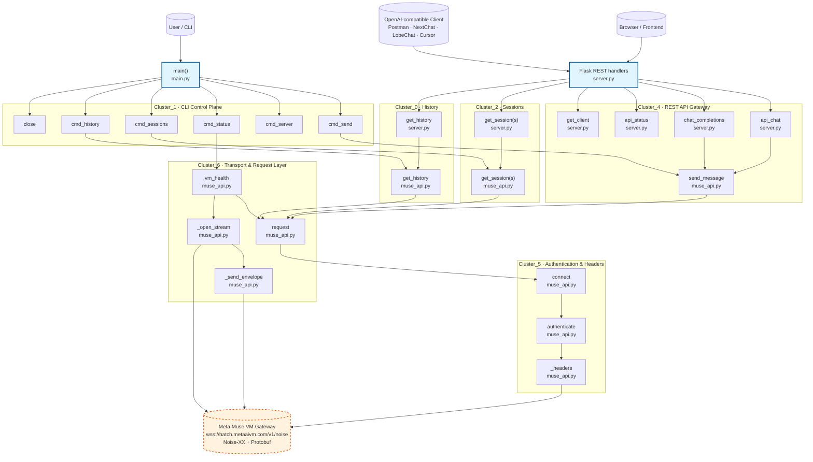

# Architecture Documentation — muse-api

> Generated from the GitNexus knowledge graph.  
> Repo: `muse-api` · 7 files · 95 symbols · 220 edges · 11 execution flows · 7 functional clusters  
> Indexed: 2026-10-29T10:03:28.327Z

## 1. Overview

**muse-api** is a local Python SDK, CLI, and OpenAI-compatible REST gateway for Meta Muse AI. It reverse-engineers the Meta Muse AI gateway, replacing the proprietary browser-based WebSocket/Protobuf path with:

1. **Cookie-based OAuth** → `access_token` + `vm_id`
2. **Notary token** (`hatch_token`) via `POST /api/hatch/token`
3. **Noise-XX encrypted WebSocket** gateway (`wss://hatch.metaaivm.com/v1/noise`)
4. **Protobuf RPC** over 258 gateway methods (`chat.stream`, `chat.history`, `sessions.list`, …)

The project exposes three consumer surfaces:

| Surface | File | Purpose |
|---------|------|---------|
| **CLI** | `main.py` | Terminal control center (`status`, `sessions`, `history`, `send`, `server`) |
| **REST gateway** | `server.py` | OpenAI-compatible `/v1/chat/completions` + internal API endpoints |
| **Core SDK** | `muse_api.py` | `MuseClient`: Noise-XX handshake, Protobuf framing, REST + WebSocket transport |

Supporting files: `routes.json` (258 gateway method catalog), `desc0.bin`/`desc1.bin` (Protobuf descriptors), `cookies.txt` (session cookies, gitignored), `start.bat` (Windows launcher), `requirements.txt` (Python deps).

## 2. Functional Areas (Clusters)

GitNexus community detection (Leiden algorithm) identified 7 clusters; 6 contain symbols. They group into six logical functional areas:

| Cluster | Symbols | Functional Area | Files |
|---------|---------|-----------------|-------|
| Cluster_1 | 5 | **CLI Control Plane** — `main` entry point + CLI commands (`cmd_send`, `cmd_server`, `cmd_status`, `close`) | `main.py`, `muse_api.py` |
| Cluster_2 | 3 | **Sessions** — `cmd_sessions` / `get_sessions` (list and fetch conversations) | `main.py`, `muse_api.py`, `server.py` |
| Cluster_0 | 3 | **History** — `get_history` / `cmd_history` (message history retrieval) | `main.py`, `muse_api.py`, `server.py` |
| Cluster_4 | 5 | **REST API Gateway** — `api_chat`, `chat_completions`, `api_status`, `get_client`, `send_message` (OpenAI-compatible endpoints) | `server.py`, `muse_api.py` |
| Cluster_5 | 3 | **Authentication & Headers** — `_headers`, `authenticate`, `connect` (Noise-XX handshake + auth headers) | `muse_api.py` |
| Cluster_6 | 4 | **Transport & Request Layer** — `request`, `_open_stream`, `_send_envelope`, `vm_health` (WebSocket stream + Protobuf envelopes) | `muse_api.py` |

Cluster cohesion ranges from ~36% to ~59%, reflecting the small, tightly-coupled nature of the codebase: most functions funnel through the shared `request` → `connect` → `authenticate` → `_headers` transport chain.

## 3. Key Execution Flows

GitNexus detected 11 execution flows. The 5 most important (by step count / centrality) are traced below. All are **cross-community** flows except `Main → Close`, which is intra-community.

### Flow 1 — Main → _headers (7 steps) — CLI session listing via full auth chain

```
1. main            (main.py)     — CLI entry point
2. cmd_sessions    (main.py)     — `sessions` subcommand
3. get_sessions    (muse_api.py) — SDK: list user conversations
4. request         (muse_api.py) — build + send Protobuf request
5. connect         (muse_api.py) — open Noise-XX WebSocket to gateway
6. authenticate    (muse_api.py) — attach auth / notary token headers
7. _headers        (muse_api.py) — construct encrypted request headers
```

### Flow 2 — Main → _send_envelope (6 steps) — CLI VM health check

```
1. main            (main.py)     — CLI entry point
2. cmd_status      (main.py)     — `status` subcommand
3. vm_health       (muse_api.py) — query VM health endpoint
4. request         (muse_api.py) — build + send Protobuf request
5. _open_stream    (muse_api.py) — open bidirectional WebSocket stream
6. _send_envelope  (muse_api.py) — send framed Protobuf envelope
```

### Flow 3 — Api_chat → _headers (6 steps) — REST chat via SDK (auth chain)

```
1. api_chat        (server.py)   — `/api/chat` REST handler
2. send_message    (muse_api.py) — SDK: send a chat message
3. request         (muse_api.py) — build + send Protobuf request
4. connect         (muse_api.py) — open Noise-XX WebSocket
5. authenticate    (muse_api.py) — attach auth headers
6. _headers        (muse_api.py) — construct encrypted headers
```

### Flow 4 — Chat_completions → _headers (6 steps) — OpenAI-compatible chat

```
1. chat_completions (server.py)  — `/v1/chat/completions` handler
2. send_message    (muse_api.py) — SDK: send a chat message
3. request         (muse_api.py) — build + send Protobuf request
4. connect         (muse_api.py) — open Noise-XX WebSocket
5. authenticate    (muse_api.py) — attach auth headers
6. _headers        (muse_api.py) — construct encrypted headers
```

### Flow 5 — Get_history → _headers (6 steps) — REST history retrieval

```
1. get_history     (server.py)   — history REST handler
2. get_history     (muse_api.py) — SDK: fetch message history
3. request         (muse_api.py) — build + send Protobuf request
4. connect         (muse_api.py) — open Noise-XX WebSocket
5. authenticate    (muse_api.py) — attach auth headers
6. _headers        (muse_api.py) — construct encrypted headers
```

**Shared transport spine:** Flows 1, 3, 4, and 5 all converge on `request → connect → authenticate → _headers` in `muse_api.py`. This is the critical path — any change here affects every chat, history, and session flow.

## 4. Architecture Diagram



### How to read the diagram

- **Blue boxes** = entry points (CLI `main()`, Flask REST handlers).
- **Colored subgraphs** = the six functional clusters discovered by GitNexus.
- **Dashed orange** = the external Meta Muse VM gateway (outside this repo).
- All user-facing flows (chat, history, sessions, status) funnel through the shared **request → connect → authenticate → _headers** spine in `muse_api.py`, then out to the Meta gateway over Noise-XX-encrypted WebSocket + Protobuf.

## 5. Index & Regeneration Notes

The knowledge graph was built with `npx gitnexus@latest analyze`. To keep documentation current:

```bash
# Refresh the index after code changes
npx gitnexus analyze --index-only

# Check index freshness
npx gitnexus status

# Re-generate this documentation from the graph
npx gitnexus wiki --force
```

Regenerating the index re-populates `gitnexus://repo/muse-api/context`, `/clusters`, `/processes`, and `/process/{name}` resources used to author this document.